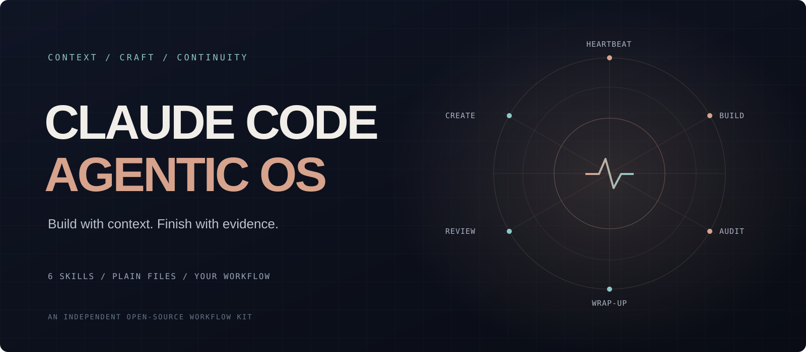
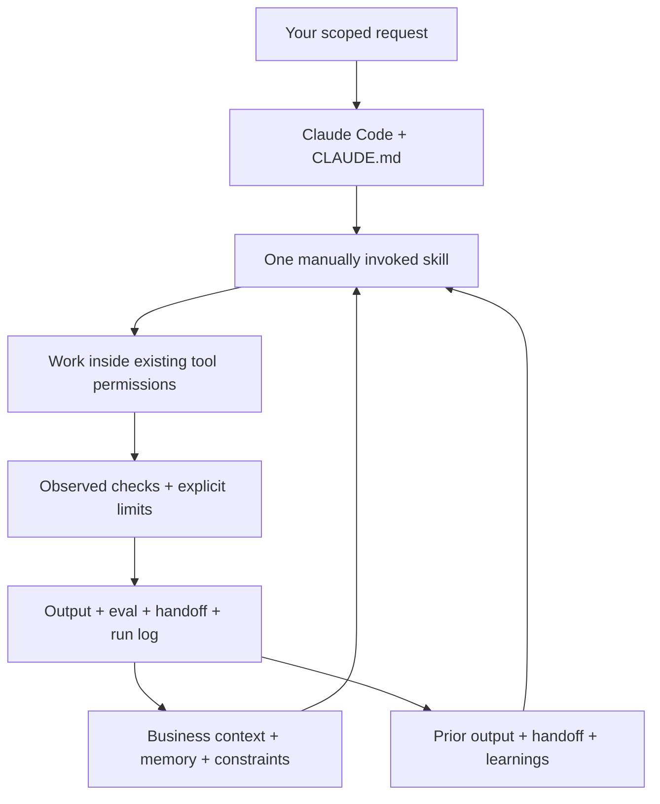

<p align="center">
  
</p>

<h1 align="center">Claude Code Agentic OS</h1>

<p align="center"><strong>Give your next coding session a past. Give your last one a handoff.</strong></p>

<p align="center">
  <a href="LICENSE"></a>
  <a href=".claude/skills"></a>
  <a href="https://code.claude.com/docs/en/skills"></a>
  <a href="docs/VERIFICATION.md"></a>
</p>

<p align="center">
  <a href="#quick-start">Start the system</a> ·
  <a href="#six-skills-one-workflow">Explore the skills</a> ·
  <a href="docs/SAFETY.md">Read the safety model</a> ·
  <a href="docs/EXAMPLES.md">Try a mission</a>
</p>

---

**A file-based workflow kit for Claude Code: six manual skills, persistent project context, practical reviews, and evidence-based handoffs.** Clone it as a dedicated operating hub, or copy its workspace files into a project with the conflict-safe installer. Everything you need to inspect is in the repository.

“Agentic OS” is a workflow metaphor. This project uses Claude Code's native `CLAUDE.md`, `.claude/skills/`, and `.claude/settings.json` conventions. It runs inside Claude Code and your existing tool permissions. It does not provide a background agent, automatic scheduling, an actual operating system, or guaranteed correctness.

## Why this exists

The expensive part of a new session is often rebuilding context: what changed, what was tested, which assumption failed, and what should happen next. This kit gives those facts a place to live, and gives repeated work a procedure you can read and change.

- **Continuity you can inspect.** Business context, decisions, constraints and current work stay in plain Markdown.
- **Work that leaves evidence.** Each skill records its output, evaluation, and next action. Initial state is explicitly `not_run`.
- **Build → review → resume.** Builder and auditor share a brief and validation record instead of a vague “done.”
- **Small enough to own.** No runtime dependencies for the workflow files; the optional installer and validator use Python's standard library.

No fabricated activity, testimonials, performance gains or production-readiness claims. Better outcomes depend on the task, the model, your permissions, and the quality of the evidence you keep.

## Quick start

### 1. Install and sign in to Claude Code

You'll need Git, a current Claude Code installation, and supported account access. Follow the [official quickstart](https://code.claude.com/docs/en/quickstart) for your platform and authentication. Python 3.10+ is required only for this kit's installer, validator and tests.

Official native install commands, for reference—review remote installers before executing them:

```bash
# macOS / Linux / WSL
curl -fsSL https://claude.ai/install.sh | bash
```

```powershell
# Windows PowerShell
irm https://claude.ai/install.ps1 | iex
```

Open a new terminal after installation and confirm `claude --version`. Run `claude` and follow its sign-in flow. This repository does not install the Claude CLI, provide a subscription, store credentials, or configure API keys.

### 2. Clone your operating hub

The following clone/start commands work in Bash and PowerShell:

```text
git clone https://github.com/choaticpixels/claude-code-agentic-os.git
cd claude-code-agentic-os
claude
```

Review `CLAUDE.md`, the settings, and skills before accepting Claude Code's folder trust prompt. Personalize [business context](agentic-os/business-brain/business-brain.md) and [constraints](agentic-os/memory/constraints.md) with non-sensitive facts. Start in this folder so Claude discovers the project files.

### 3. Run your first workflow

Type these **one at a time inside Claude Code**, letting each finish:

```text
/heartbeat
/project-builder Build a small dependency-free Node.js health-check API in projects/health-api with GET /health, a README, and node:test checks. Keep it local.
/project-auditor projects/health-api
/wrap-up
```

The expected outcome is a real local project plus reports in `agentic-os/state/skills/`. Inspect those files and run the app yourself. These are instructions for a runtime smoke test; the repository does not pretend this sample has already been executed.

### Install into another project

From the source clone, preview and then copy the workspace kit:

```text
python scripts/install.py --target "../my-project" --dry-run
python scripts/install.py --target "../my-project"
python scripts/validate.py --root "../my-project"
cd ../my-project
claude
```

On Windows, use `py` if `python` is unavailable; on macOS/Linux use `python3` when appropriate. The installer copies only the files in [manifest.json](manifest.json), including the six skills, settings, memory, state and helpers. It makes no network calls and registers no tasks. Existing destination files cause a preflight refusal before any copy. Symlink/junction paths are rejected. A later I/O failure may leave a partial install; review it before retrying.

If a project already has `CLAUDE.md`, settings or skill state, install into a separate empty folder and merge deliberately with version control. There is no force-overwrite option. Shared directories such as an existing `.claude/` are fine when none of the destination files conflict. Installation details, safe updates and removal are in [Setup](docs/SETUP.md).

## Six skills, one workflow

| Command | Use it when… | Result you can inspect |
| --- | --- | --- |
| `/heartbeat` | Starting a session or checking continuity | Missing files, stale context, open errors, next action |
| `/project-builder <request>` | Building a project, fixing a bug, or adding a feature | Real files, brief, assumptions, validation and handoff |
| `/project-auditor <target>` | Checking work against its acceptance criteria | Prioritized findings, actual checks and coverage limits |
| `/skill-creator <workflow>` | A repeated procedure deserves its own command | A scoped `SKILL.md`, state files and validation criteria |
| `/system-review` | Maintaining the kit after changes or every 4–6 weeks | Instruction conflicts, stale memory and proposed cleanup |
| `/wrap-up` | Ending work or preparing a handoff | Current continuity notes, evidence and next steps |

All six use `disable-model-invocation: true`: invoke them explicitly. They do not automatically call one another. Use arguments for the live request; when absent, relevant skills use their saved `input.md`. User arguments take precedence over old input. The local `/skill-creator` may share a name with a personal or plugin skill: check the `/` menu and resolve collisions before use.

## Architecture



```text
CLAUDE.md                         Entry instructions and explicit context reads
.claude/
  settings.json                   Reviewed settings; no broad allow rules
  skills/<six skills>/SKILL.md     Native Claude Code workflow commands
agentic-os/
  business-brain/                  Shared facts you supply
  memory/                         Durable facts, decisions, current continuity
  workflows/                      Lifecycle and builder maps
  state/skills/<name>/             Input, output, handoff, learnings, eval.json
  logs/                           Run/error history and JSONL evaluations
  scripts/                        Interactive launchers; opt-in offline schedules
  system/                         Rules, file map and verification boundaries
scripts/                          Distribution installer and offline validator
tests/                            Installer behavior and preservation checks
docs/                             Setup, examples, safety, sources, verification
assets/                           Original banner and social-preview artwork
```

Every skill follows a [shared run protocol](agentic-os/system/operating-rules.md). The builder also maintains `project-brief.md`, `assumptions.md`, and `validation.md`. Evaluations use `not_run`, `pass`, `partial`, `fail`, or `blocked`, with evidence and a timestamp. They are agent self-evaluations, not independent certification.

### What “persistent memory” means here

This kit's `agentic-os/memory/MEMORY.md` is a project file that `CLAUDE.md` and the skills instruct Claude to read. It is distinct from Claude Code's built-in auto memory. Markdown files do not execute or inject themselves. Keeping them concise, accurate and current is part of using the workflow. See the official [memory documentation](https://code.claude.com/docs/en/memory) for Claude Code's own memory behavior.

## Safety and honest completion

- The settings include `disableSkillShellExecution: true` and file/tool deny rules. They add no broad allow rules, hooks, MCP services or permission-bypass flags.
- The skills prohibit secret-value reads, environment dumps and secret logging; examples use variable names only. `.gitignore` reduces accidental commits but does not remove tracked content.
- Deny rules are **defense in depth**, not an OS security boundary. Arbitrary subprocesses, external tools and existing settings can change the risk. Review commands and permissions; use appropriate OS isolation for untrusted work.
- Runtime memory and state may contain private information. The installer includes an `agentic-os/.gitignore` for new projects. A source clone's starter files are already tracked, so review changes before pushing your working hub.
- Publishing, deployment, live trades, messages, scheduling and spending require authorization for the actual action. A stored handoff is not new authority.
- Use one writer per workspace. File-based state has no locking or automatic conflict resolution.

Read the full [safety model](docs/SAFETY.md) before connecting the kit to sensitive systems. Claude permission behavior is documented in [Configure permissions](https://code.claude.com/docs/en/permissions).

## Verification

```text
python scripts/validate.py
python -m unittest discover -s tests -v
```

The validator checks required files, simple skill metadata, JSON and local Markdown links. Tests exercise clean installation, byte preservation, dry-run behavior, conflict refusal, manifest path traversal, missing files and symlink rejection. Neither runs a Claude model, audits a product, nor proves platform-wide compatibility. The [verification record](docs/VERIFICATION.md) reports the checks actually performed and their limits.

A [manual GitHub Actions workflow](.github/workflows/validate.yml) is included. It runs only when you dispatch it; cloning or pushing does not start a paid build or model call.

## Heartbeat helpers and scheduling

`bash agentic-os/scripts/run-heartbeat.sh` or `./agentic-os/scripts/run-heartbeat.ps1` starts **one interactive** Claude session with `/heartbeat` prefilled. It still needs your installed CLI, account, trust and permissions.

The Windows Task Scheduler and cron files are opt-in **offline structural-check examples**, not scheduled Claude runs. The Windows example previews by default and registers only with `-Register`. No task is installed by cloning or running the installer. [Scheduling details](docs/SETUP.md#optional-offline-scheduling) explain paths, verification and removal.

## Troubleshooting

| Symptom | Check / next action |
| --- | --- |
| `claude` isn't found | Reopen the terminal and follow the official installation/PATH guide; this kit does not install it. |
| A command is missing | Start Claude in the workspace root; check `.claude/skills/<name>/SKILL.md`, valid frontmatter, name collisions and your effective settings; restart the session after installation. |
| Skills do not run automatically | Expected: all six are manual. Type `/heartbeat`, for example, at the prompt. |
| Installer stops at an existing file | Install to a separate folder and merge reviewed changes. Do not overwrite local instructions or state. |
| `Read` is denied for a safe example file | `.env.*` patterns also cover `.env.example`. Document variable names in README/config docs, or deliberately review a narrower local policy. |
| A tool or state write is denied | Inspect effective permissions and managed policies; record the blocked action. Do not bypass permissions to get a passing report. |
| Reports say `not_run` | Starter state is deliberately empty. Invoke a skill; structural validation is separate from runtime evaluation. |
| Memory seems forgotten | Inspect the short context files and CLAUDE.md read instructions; confirm the relevant file was read. Avoid relying on long, stale notes. |
| Heartbeat never runs in the background | No daemon is installed. Launch it manually; offline scheduling examples do not call Claude. |
| Concurrent runs overwrite handoffs | Use separate workspaces/worktrees, then reconcile changes. |

## Examples and customization

Try a [local API, a scoped bug fix, an audit, or a reusable workflow](docs/EXAMPLES.md). Adapt the supplied business brain and constraints first. Prefer a small verified task before connecting external services. Review instruction freshness with `/system-review` as your tools change.

## Contributing

Useful contributions include reproducible bugs, clearer safety boundaries, smaller skill instructions, and verified platform fixes. Start with [CONTRIBUTING.md](CONTRIBUTING.md). Reports should state the platform, relevant versions, expected/actual behavior, and redacted reproduction steps. Do not attach private workspace state or credentials. Use the [issue templates](.github/ISSUE_TEMPLATE) for structured reports.

## Attribution and license

Created by [choaticpixels](https://github.com/choaticpixels), based on the owner's six-skill Agentic OS design, with AI-assisted implementation and documentation. Original wording and artwork in this repository are provided under the [MIT License](LICENSE). Claude and Claude Code are Anthropic products; this is an independent community project, not affiliated with or endorsed by Anthropic. The MIT license does not grant rights to Anthropic trademarks or third-party services.

Compatibility choices were checked against [official Claude Code documentation](docs/SOURCES.md) on **November 14, 2026**. Documentation can change; consult those sources before updating settings. This release is a first public workflow kit with offline verification, not a claim of universal or production-proven behavior.

---

<p align="center"><strong>Keep the context. Inspect the evidence. Leave the next session a way forward.</strong></p>
<p align="center">Claude Code skills · agentic workflows · persistent project memory · AI coding agents · software automation</p>
